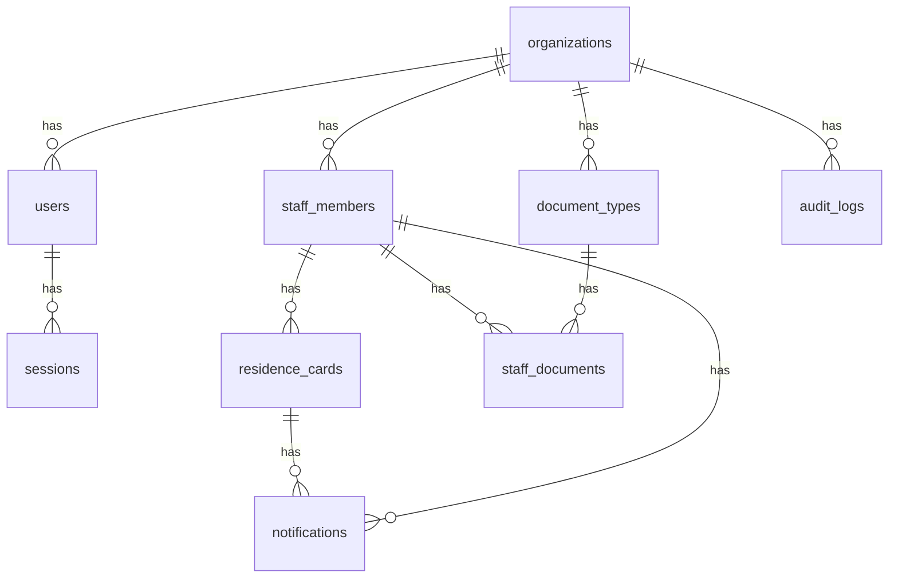

# ER（9テーブル）

全データは架空です。テナントを持つテーブルは `organization_id` を持ち、親と同じ組織であることをモデルの検証で保証します。

| テーブル | 主な列・制約 |
|---|---|
| organizations | name, slug（一意） |
| users | organization_id, email_address, password_digest, role（admin／member。CHECK） |
| sessions | user_id, ip_address, user_agent（標準認証） |
| staff_members | organization_id, employee_code（組織内で一意）, full_name, birth_on, nationality, hired_on, status（active／left。CHECK） ほか |
| residence_cards | staff_member_id, status_of_residence, card_number_last4（下4桁のみ）, issued_on, expires_on。履歴として複数持ち、current は expires_on が最大の1件 |
| document_types | organization_id, name（組織内で一意）, required, renew_interval_months |
| staff_documents | staff_member_id, document_type_id（組合せで一意）, state（missing／submitted／approved／expired。CHECK） |
| notifications | residence_card_id＋kind で一意（冪等性の根拠）, kind（expiry_90／60／30／expired。CHECK）, mail_subject, mail_body |
| audit_logs | organization_id, user_id（NULL可）, action, target_type, target_id, changes_json, created_at |

正確な列型・外部キー・索引は `db/schema.rb` を参照してください。
